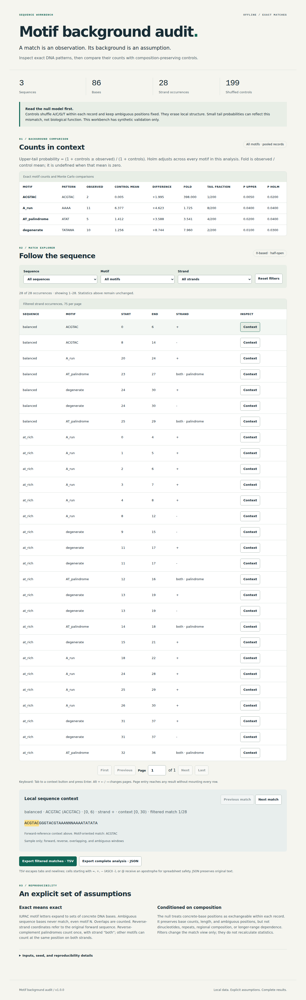

# Motif background audit

An offline DNA motif workbench for exact IUPAC pattern matching and an explicit question: **how do composition-preserving shuffled controls change apparent enrichment?**

Give it local FASTA and a motif manifest. It writes complete JSON, spreadsheet-safe TSV, and a self-contained HTML report with sequence/motif/strand filters, paged matches, keyboard controls, and highlighted sequence context. The CLI and report need no network or third-party runtime packages.



## Run locally

Requires Python **3.12 or later**. Linux is the validated platform; the CLI's hard wall-clock timer and cancellation handling use POSIX signals. No pip or package download is needed:

```sh
python3 scripts/install.py --prefix /tmp/motif-audit-install
/tmp/motif-audit-install/bin/motif-audit \
  --fasta examples/sequences.fasta \
  --motifs examples/motifs.json \
  --out /tmp/my-motif-report --seed 1729 --shuffles 199
```

Open `/tmp/my-motif-report/report.html` in a browser. Use a **new** output directory; its parent must already exist. Re-running against an existing path is an error, never an overwrite. To run directly from the checkout, use `python3 -m motif_audit` with the same arguments.

The installer creates an executable standard-library zipapp at `PREFIX/bin/motif-audit`; it also refuses to overwrite. Python remains required on PATH. Remove that file to uninstall. No web server, account, API key, or GPU is involved.

A manifest is deliberately small and explicit:

```json
{"motifs": [{"id": "target", "pattern": "ACGTAC"}, {"id": "degenerate", "pattern": "TATAWA"}]}
```

## What the results mean

- Motif letters represent concrete-base sets. Ambiguous **sequence** bases never match, even motif `N`. Inputs normalize ASCII DNA letters to uppercase.
- Overlapping windows count. Both strands are searched. Coordinates are **zero-based, half-open on the original forward reference**, including reverse-strand hits.
- A reverse-complement palindrome counts once with strand `both`. Other motifs can count twice at a position if both orientations match.
- Controls permute A/C/G/T **within each record**, preserving counts and ambiguous positions. This assumes exchangeability and destroys dinucleotide, regional, and longer-range structure.
- Upper-tail probabilities use `(1 + controls >= observed) / (1 + controls)`. Holm adjustment covers every motif in the analysis. Report filters only change the match view, never the statistical family.
- Exact matches, small probabilities, and large effects **do not establish biological function**. Validation is synthetic only; no Evo2 inference or experimental confirmation was performed.

See [input and output contracts](docs/contracts.md), [methods and existing work](docs/methods.md), and [complete experimental results](docs/results.md). This is an exact-pattern diagnostic, not a replacement for probabilistic motif scoring in MEME/FIMO. No novelty is claimed.

## Verify

The full verification command is:

```sh
python3 scripts/verify.py --browser
```

Chromium tests additionally require Node.js and the pinned development dependency. Provision these once, outside offline execution:

```sh
npm ci
npx playwright install chromium
```

On minimal Linux systems Chromium also requires system browser libraries. This repository does not install system packages. Existing installations can be supplied with `--playwright-module /absolute/path/to/playwright` and `--browsers-path /absolute/cache/path`.

Without browser tooling, `python3 scripts/verify.py` runs the Python, installed-CLI, and experiment checks and explicitly records that browser checks were not requested. `--browser` fails if browser tooling is unavailable; it never silently skips. Verification also requires `/usr/bin/time` for the measured isolated CLI workflow. Add `--record /tmp/motif-evidence` to retain new evidence. Tests use temporary paths and leave inputs unchanged.

Verification includes a separate brute-force matcher on 500 seeded cases, 500 independent shuffle-invariant cases, exact arithmetic checks, malformed input and resource-limit errors, real cancellation signals, output collisions, serialization/write cleanup, every saved experimental control count, and a repeated installed CLI workflow with networking disabled. Chromium checks every page of a 2,599-occurrence fixture with external networking blocked. Full details, dependency versions, runtime/RSS, artifact sizes, and screenshots are in [recorded evidence](results/verification/verification.json).

The experiment protocol and runner were [locally frozen and hashed](experiments/frozen.json) before evaluation. To repeat the CPU-bounded experiment into a fresh directory:

```sh
python3 scripts/experiment.py --out /tmp/motif-experiment
python3 scripts/audit_experiment.py /tmp/motif-experiment
```

All 32 original inputs, 199 controls per dataset, seeds, hashes, and results are retained under [results/experiment](results/experiment). The first evaluation took 14.44 seconds with peak process RSS 20,992 KiB. The 30-minute experiment budget is enforced separately from each analysis's 120-second ceiling.

## Scope and limits

This is a modest local workbench, not a genome-scale scanner. It refuses over-budget input or output; it never presents truncated matches as a complete analysis. Default hard ceilings include 1 MiB FASTA, 100,000 bases per record, 200,000 total bases, 32 motifs, 30,000 occurrences in either observed or any control scan, 999 shuffles, a conservative 120-million-work-unit bound, 120 seconds per CLI call, and 8 MiB per report/artifact. Details and failure semantics are in [contracts](docs/contracts.md).

Published evidence uses synthetic data. A locally generated report embeds the full normalized sequences and descriptions, so sharing the report shares those inputs. The browser uses native HTML tables and controls; Chromium desktop and a 375px viewport were exercised, but screen-reader and cross-browser validation remain unperformed.
